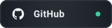

<!-- ==================== HERO BANNER ==================== -->

  

    

  <!-- Animated Social Buttons -->
  
  &nbsp;&nbsp;
  
  &nbsp;&nbsp;
  
  &nbsp;&nbsp;
  

---

<!-- ==================== ABOUT ME ==================== -->
### About Me

I'm **Md. Muntasir Bin Rafique (Akib)**, a Computer Science & Engineering undergrad at **BUET** (Level 2, Term 2).

I like building software from the ground up—whether that's tackling algorithmic problems in C++, designing clean object-oriented applications, building full-stack web projects, or diving into signal processing and machine learning research.

I also enjoy teaching math and physics, and outside of coding you'll usually find me bowling pace on the cricket pitch, playing football, or hitting the gym.

---

<!-- ==================== PROJECTS ==================== -->
### Projects

| Repository | Stack | Overview |
| :--- | :--- | :--- |
| [**SpectralWizards**](https://github.com/AKIBcoderbai/SpectralWizards) | `Python` `PyTorch` | Signal extraction & ML research project |
| [**SignalProject**](https://github.com/AKIBcoderbai/SignalProject) | `Python` | Signal analysis and filtering pipeline |
| [**Max_Flow**](https://github.com/AKIBcoderbai/Max_Flow) | `C++` | Maximum flow graph algorithm implementations |
| [**CHALDAAL**](https://github.com/AKIBcoderbai/CHALDAAL) | `JavaScript` | E-commerce web application clone |
| [**SWE**](https://github.com/AKIBcoderbai/SWE) · [**chess-game**](https://github.com/AKIBcoderbai/chess-game) | `Java` | Software design patterns & desktop chess game |
| [**Jan2026_CSE220_Offline_DFT_FFT**](https://github.com/AKIBcoderbai/Jan2026_CSE220_Offline_DFT_FFT) | `Python` | Discrete & Fast Fourier Transform implementations |

---

<!-- ==================== TECH STACK ==================== -->
### Tech Stack

  
  
  
  
  
  
  
  

---

<!-- ==================== GITHUB STATS ==================== -->
### GitHub Stats

  
  

   

  

