About MeI'm Md. Muntasir Bin Rafique (Akib), a Computer Science & Engineering undergrad at BUET (Level 2, Term 2).I like building software from the ground up—whether that's tackling algorithmic problems in C++, designing clean object-oriented applications, building full-stack web projects, or diving into signal processing and machine learning research. I also enjoy teaching math and physics, and outside of coding you'll usually find me bowling pace on the cricket pitch, playing football, or hitting the gym.ProjectsRepositoryStackOverviewSpectralWizardsPython PyTorchSignal extraction & ML research projectSignalProjectPythonSignal analysis and filtering pipelineMax_FlowC++Maximum flow graph algorithm implementationsCHALDAALJavaScriptE-commerce web application cloneSWE · chess-gameJavaSoftware design patterns & desktop chess gameJan2026_CSE220_Offline_DFT_FFTPythonDiscrete & Fast Fourier Transform implementationsTech Stack

GitHub Stats

