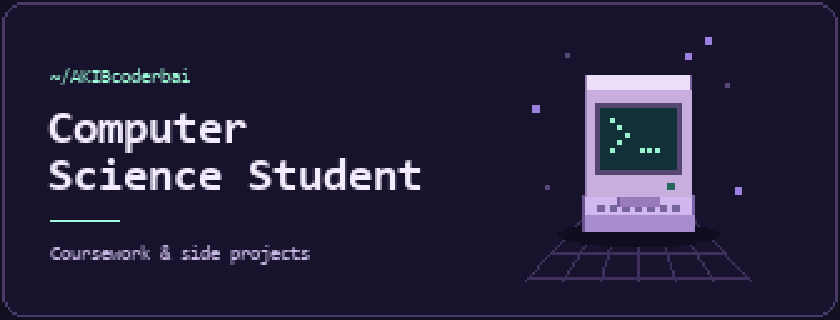

  <picture>
    <source media="(prefers-reduced-motion: reduce)" srcset="./assets/retro-computer.png">
    
  </picture>

<!-- Edit the sections below as your interests and projects change. -->

## About me

I’m a computer science student. This is where I keep my projects, experiments, and notes on what I’m learning.

## Currently learning

<!-- Swap these starter topics for what you're working on. -->

- Data structures and algorithms
- Git and the command line
- Building and documenting small programs

## Projects

<!-- Replace these prompts with links to your own repositories. -->

- **Coursework** · Add a class project and explain what you built.
- **Side project** · Add something you made outside class and what you learned.
